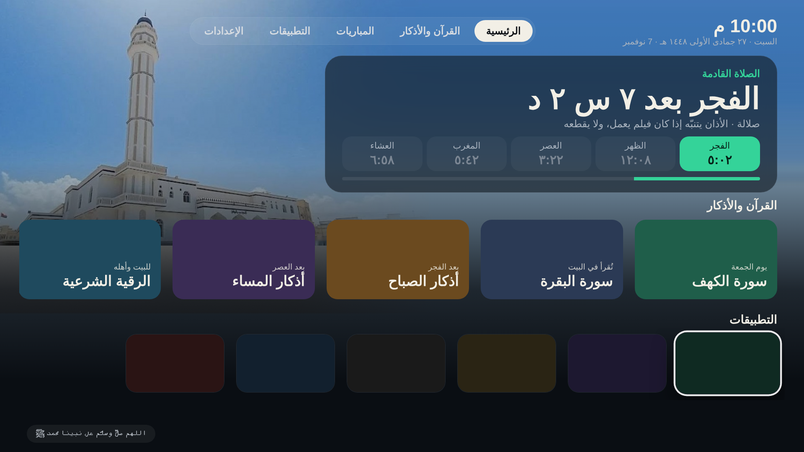

# 📺 DriveCast TV

### شاشة رئيسية نظيفة لتلفزيونك: بلا إعلانات، تأذّن وتذكّرك بالصلاة، وفيها مباريات اليوم

كلود يركّبها لك ويمشّيك خطوة خطوة.

## شنو فيها؟

- 🕌 **الصلاة القادمة** بالعد التنازلي ومواقيت اليوم، والأذان بالصوت أو بشريط صغير فوق الفيلم بدون ما يقطعه
- 📖 **القرآن والأذكار:** سورة الكهف، البقرة، أذكار الصباح والمساء، الرقية، بضغطة وحدة
- ⚽ **مباريات اليوم** من DriveCast: المباشر والنتائج ومواعيد اللي ما بدأت
- 📱 **التطبيقات** مرتبة حسب استخدامك، بصورها الكبيرة
- 💌 **صفحة الجوال** `http://<آي بي التلفزيون>:8080`: اكتب كلمة أو ارسم بإصبعك وتطلع على الشاشة
- ﷺ **كل 45 دقيقة** سطر يذكّرك بالصلاة على النبي، ويوم الجمعة بسورة الكهف
- 🌿 **فوق الساعة:** التاريخ الهجري، «جمعة مباركة» يوم الجمعة، و«الأيام البيض» بالذهبي
- 🕌 **الخلفية:** جامع عمر الرواس بصلالة، أو أشكال نور تي في الثلاثة (الزخرفة، مسجد الليل، أوقات اليوم اللي تتغيّر مع الصبح والعصر والليل)، تختارها من «الإعدادات»
- 🧹 **بلا إعلانات:** يعطّل تطبيقات الشركة اللي تعرض الإعلانات (**تعطيل مو حذف**، وترجع بأمر واحد)

## يشتغل على شنو؟

✅ أندرويد تي في وقوقل تي في والتي في بوكس الأندرويد
❌ سامسونق (تايزن)، إل جي (ويب أو إس)، وهايسنس VIDAA: أنظمتها مو أندرويد

## تحتاج

1. لابتوب (ماك أو ويندوز) فيه [Claude Code](https://claude.com/claude-code)
2. التلفزيون واللابتوب على **نفس الواي فاي**

## ابدأ

افتح Claude Code وقل له:

> ركّب لي DriveCast TV من github.com/mazenDevloper/drivecast-tv واقرأ skills/drivecast-tv/SKILL.md وامشِ عليه خطوة خطوة

أو ثبّته كإضافة: `/plugin marketplace add mazenDevloper/drivecast-tv`

الخطوة الوحيدة اللي تسويها بإيدك: تفعيل «خيارات المطوّر» بالتلفزيون، وكلود يشرحها لك.

## الرجوع

كل شي ينحفظ قبل التغيير. للرجوع: `bash <مجلد النسخة الاحتياطية>/restore.sh`.

## شكر

مبني على أفكار [noor-tv](https://github.com/majedphotos/noor-tv) لـ majedphotos وأجزاء من كوده (الأذان، التذكير، صفحة الجوال، أدوات النسخ والتعطيل) برخصة MIT. الفرق: تطبيق واحد جاهز هو نفسه الشاشة الرئيسية، بدون بناء على جهازك.

